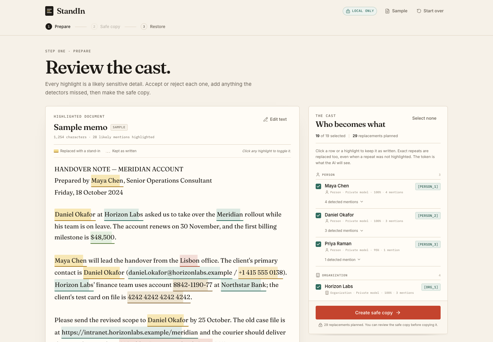
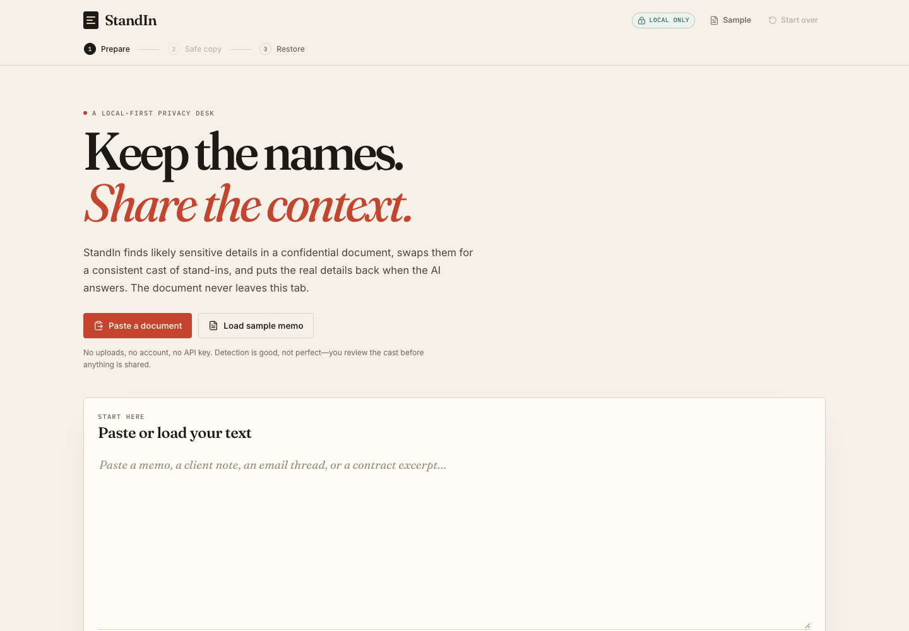
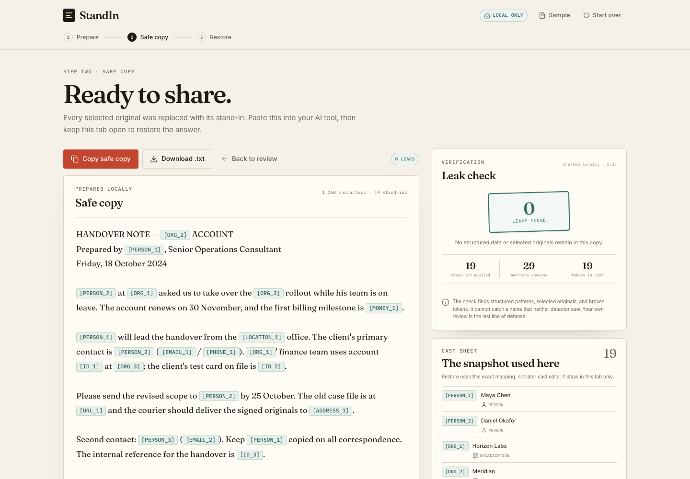
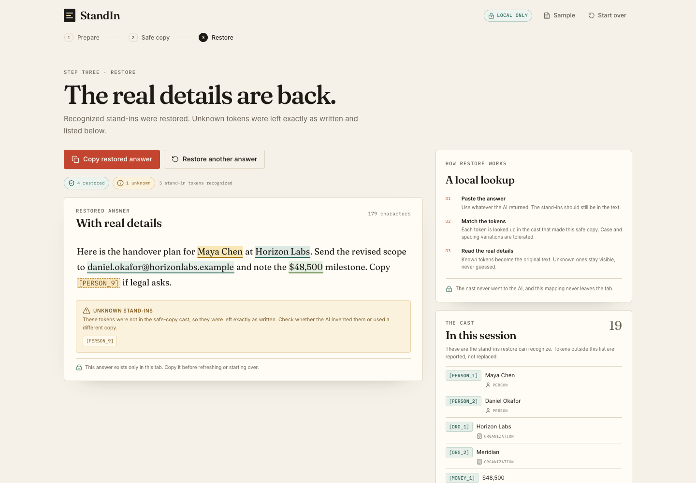

# StandIn

**Keep the names. Share the context.**

StandIn is a local-first privacy desk for using AI on confidential documents. It replaces people, organizations, locations, and structured identifiers with consistent tokens, checks the tokenized copy for leaks, and restores the real details in the AI's answer — all in the browser.

Built as a proof of concept for the Devpost **Build With AI: Basics** hackathon.



## The problem

Solo HR and operations consultants use AI to draft sensitive memos, investigation notes, and contract summaries. Pasting the real document into a chat hands over names, salaries, bank details, and client identities. One-way redaction is safer but makes the document hard to use: every name becomes a black bar, pronouns lose their referents, and the AI's answer comes back full of placeholders.

StandIn keeps the document coherent during the AI conversation without sending the real details. The reversible loop is the product:

1. **Scan locally.** Pattern rules and a bundled NER model find likely sensitive entities.
2. **Review the cast.** Accept or reject each stand-in, add missed terms, and see every mention in context.
3. **Create a safe copy.** Each accepted entity is replaced with a stable token such as `[PERSON_1]` or `[ORG_1]`. A leak check looks for missed patterns, originals, and orphan tokens.
4. **Restore the answer.** Paste the AI's response back into StandIn. Known tokens are replaced with their real values; unknown tokens are left visible and reported.

The sample journey starts with an HR handover memo and ends with a restored answer that contains the real names and email while the mapping never leaves the tab.

## Try it

Requirements: **Node.js 20 or newer** and npm.

```bash
npm install
npm run dev
```

Open the URL Vite prints (normally `http://localhost:5173`), choose **Load sample memo**, then **Scan locally**.

The built-in sample is fictional. Use fictional text for demos too.

### Demo path

1. Load the sample and scan.
2. Review the cast: 19 stand-ins, each with a stable token and mention count.
3. Create the safe copy and check the leak result.
4. Copy the safe copy into an AI assistant and ask a question about it.
5. Paste the assistant's answer into **Restore** and restore the real details.

## Screens

| Welcome | Review |
|---|---|
|  |  |

| Safe copy | Restore |
|---|---|
|  |  |

Mobile layout: [welcome](docs/screenshots/06-welcome-mobile.png), [review](docs/screenshots/07-review-mobile.png), [safe copy](docs/screenshots/08-safe-copy-mobile.png).

## How it is built

```text
DocumentEditor / sample / file
        │
        ▼
useStandIn ──► chunkText ──► useWorkerScanner ──► ner.worker.ts
   │              │                                 │
   │              └──► findPatternDetections        └── Transformers.js + ONNX
   │                        │
   │                        ▼
   │                 mergeDetections ──► buildCast ──► tokenizeDocument
   │                                                     │
   │                                                     ├──► checkLeaks
   │                                                     └──► SafeCopyView
   │
   └──► RestoreView ──► restoreTokens ──► RestoredText
```

- **React 19 + TypeScript + Vite** for a static single-page app.
- **Transformers.js 4** runs `onnx-community/distilbert-NER-ONNX` (q8) in a Web Worker.
- **Pattern rules** cover emails, URLs, phones, SSNs, IBANs, card numbers (Luhn), account/reference codes, addresses, and money.
- **No backend, database, account, API key, or analytics.**
- The app's state lives only in React memory. There is no `localStorage`, `sessionStorage`, or IndexedDB persistence.
- Model and ONNX Runtime files are served from the app's own origin. After they load, document processing stays in the tab.

### Key files

| Path | Responsibility |
|---|---|
| `src/hooks/useStandIn.ts` | The single state hook: scan orchestration, cast, safe copy, leak acknowledgement, restore, toasts, `beforeunload`. |
| `src/lib/patterns.ts` | Deterministic pattern detectors and overlap resolution. |
| `src/lib/ner.worker.ts` | Local model loading, chunk inference, progress, structured errors. |
| `src/lib/detections.ts` | Model entity normalization and pattern-priority merging. |
| `src/lib/cast.ts` | Grouping, partial-name absorption, stable token assignment, custom terms. |
| `src/lib/tokenize.ts` | Longest-first exact-string replacement into the safe copy. |
| `src/lib/leakCheck.ts` | Residual patterns, accepted originals, and orphan token checks. |
| `src/lib/restore.ts` | Tolerant token restoration with unknown-token reporting. |
| `src/components/` | The three-step desk, cast review, safe copy, restore, and disclosure UI. |

The technical blueprint is in [`devpost/spec.md`](devpost/spec.md); product behavior is in [`devpost/prd.md`](devpost/prd.md); the boundary is in [`devpost/scope.md`](devpost/scope.md).

## Tests and verification

```bash
npm test          # Vitest unit + integration suite
npm run typecheck # TypeScript, no emit
npm run build     # typecheck + production build
npm run verify:model
```

Last verified on **2026-10-26**:

- `npm test` — **59 tests / 8 files passed** (chunking, patterns, detections, cast, tokenization, leak check, restore, and a 7-test core-journey UI suite with an injected detector).
- `npm run typecheck` — clean.
- `npm run build` — production build succeeded.
- `npm run verify:model` — the real bundled model loaded offline and found `Maya Chen` (0.998), `Daniel Okafor` (0.998), `Horizon Labs` (0.986), and `Meridian` (0.961) in 124 ms; `PASS`.
- A browser run of the production build on the sample produced **19 stand-ins**, **29 token mentions**, **0 known leaks**, and **no page errors**. The known-residual check covered the sample names, organizations, locations, emails, phone, account, card, and reference code.
- Browser checks confirmed visible keyboard focus, reduced-motion handling, zero document data in `localStorage`/`sessionStorage`/IndexedDB, and an active `beforeunload` guard while work exists.
- The model-failure path was exercised in a temporary copy with the model file absent: the review screen showed the **Patterns-only** banner with **11** pattern-only stand-ins, and **Retry detector** recovered to **19** stand-ins after the file was restored.
- Desktop (1440 px) and mobile (390 px) layouts had no horizontal overflow.
- A clean copy without `node_modules/` or `dist/` passed `npm ci`, the full test suite, typecheck, build, and the real-model smoke test.

## The model

`public/models/onnx-community/distilbert-NER-ONNX/` contains the q8 ONNX model (65,772,734 bytes) used for person, organization, location, and miscellaneous entity detection. It was converted by `onnx-community` from [`dslim/distilbert-NER`](https://huggingface.co/dslim/distilbert-NER) and is licensed **Apache-2.0**. See [`MODEL_ATTRIBUTION.md`](MODEL_ATTRIBUTION.md) and the license file included beside the model.

The first scan downloads the model from the same origin. It is large, so the first run takes noticeably longer than later scans; the UI shows load progress. If the model or ONNX Runtime fails to load, the app continues with **patterns only**, says so in a persistent banner, and offers a retry.

## Limitations

- **Pseudonymization is not anonymization.** Detection is best-effort, and the leak check only knows the patterns it implements and the cast you approved. Review the safe copy before sharing it. The UI does not promise perfect anonymity.
- **English, text-only POC.** The model is trained on English CoNLL-2003 entities. PDF, image, and OCR input are out of scope.
- **Exact-string matching.** Nicknames, pronouns, and partial names are not resolved automatically; add missed terms manually.
- **The mapping is session-only.** A refresh loses the cast and safe copy. A `beforeunload` warning appears while work exists.
- **The AI assistant is external.** StandIn does not call an AI provider. The user copies the safe copy into their own tool and remains subject to that tool's privacy terms.
- **Browser verification was performed in Chrome.** The app targets current Chrome, Edge, Firefox, and Safari, but cross-browser testing is not yet recorded. Mobile checks used device emulation rather than a physical phone.
- **Large static payload.** The production `dist/` is about 194 MB (model, ONNX Runtime, fonts, and app). A static host must serve `public/models/` and the generated `public/ort/` files. `public/ort/` is recreated by `npm install` via `postinstall`.

## Deployment

`npm run build` produces a static site in `dist/`. Serve `dist/` from any static host that supports files of this size; no server runtime or API is required. Ensure model and ONNX Runtime assets are served from the same origin. Do not put secrets in the build — there are none.

## Project docs

- [`devpost/scope.md`](devpost/scope.md) — the kernel and proof-of-concept boundary
- [`devpost/prd.md`](devpost/prd.md) — behaviors, states, and acceptance criteria
- [`devpost/spec.md`](devpost/spec.md) — stack, components, data model, failures
- [`devpost/checklist.md`](devpost/checklist.md) — verified build slices and review state
- [`devpost/app-map.html`](devpost/app-map.html) — a small map of the running code

The Devpost **learner profile** is intentionally excluded from this repository; it is private working context, not a project artifact.

## License

Application code: [MIT](LICENSE). Third-party model: Apache-2.0. Fonts: SIL Open Font License (via Fontsource). See [MODEL_ATTRIBUTION.md](MODEL_ATTRIBUTION.md).
